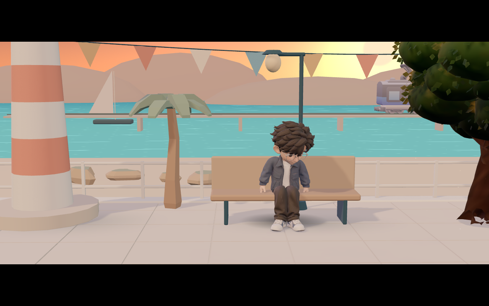

# Hi, I'm Zheng Wenhong

### Full-Stack & AI Developer

Building AI tools, exploring knowledge systems, and creating interactive experiences.

[Portfolio](https://yantu.cloudns.club/) · [GitHub](https://github.com/zhengwenhong123) · [X / @starweave_verse](https://x.com/starweave_verse) · [Email](mailto:z1716142352@gmail.com)

 

A real scene from my portfolio. Click the image to explore the journey.

## About me

I'm interested in the space where AI applications, developer tools, and thoughtful interfaces meet. I enjoy turning ideas into working tools and documenting what I learn along the way.

我关注 AI 应用、Agent 工具链与知识管理，也喜欢用交互和三维场景表达想法。这里记录我的项目、实验，以及持续学习的过程。

- **Building:** a personal portfolio that connects an animated character, project showcases, and a journey from the studio to the coast.
- **Exploring:** agent harnesses, persistent task state, LLM tracing and evaluation, and AI-assisted knowledge workflows.
- **Learning:** Go, AI infrastructure, and system design.

## Tools & interests

These are the languages and tools I use or explore across projects.

| Area | Languages & tools |
| --- | --- |
| Languages | Python · TypeScript · Java |
| Agents & workflows | LangChain · Pi Durable · Deep Agents |
| Observability & evaluation | Langfuse |
| Web & interactive graphics | React · Three.js · WebGL |
| Backend & deployment | Node.js · Cloudflare · Vercel |
| Development workflow | Git · GitHub Actions · Codex · Claude Code · Muse |
| Knowledge systems | Obsidian · AI-assisted research and documentation |

## Featured work

### A creative journey — interactive 3D portfolio

An animated character guides visitors through a studio, a technology shelf, a project street, a train ride, and a coastal ending. Scroll, explore projects, and switch between Chinese and English.

- Character animation, scene transitions, and interactive project screens.
- A smaller character download and lighter rendering for touch devices.
- GitHub Actions checks and automatic production deployments on Vercel.

**[Explore the live site →](https://yantu.cloudns.club/)**

The portfolio source is currently private; the deployed experience is public.

## What I'm exploring next

- **Agent workflows:** planning, tools, context management, and reliable execution.
- **Knowledge systems:** connecting notes, source material, and AI-assisted discovery.
- **LLM observability:** understanding traces, evaluating outputs, and tracking latency and cost.
- **Web performance:** keeping interactive experiences usable across desktop and mobile.

## Let's connect

I'm happy to exchange ideas about AI applications, developer tools, knowledge workflows, and interactive web experiences.

- **Portfolio:** [yantu.cloudns.club](https://yantu.cloudns.club/)
- **Email:** [z1716142352@gmail.com](mailto:z1716142352@gmail.com)
- **X:** [@starweave_verse](https://x.com/starweave_verse)
- **GitHub:** [@zhengwenhong123](https://github.com/zhengwenhong123)

---

From ideas to things you can try.

