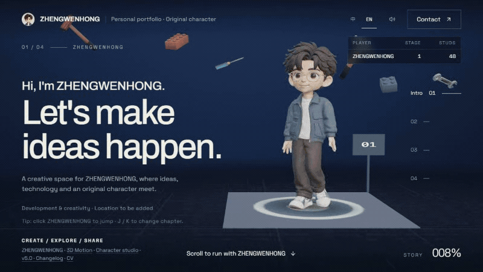
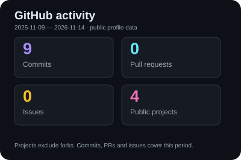
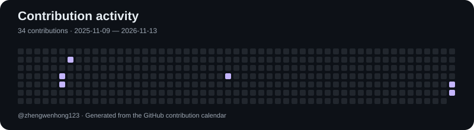
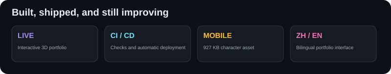

<div align="center">

# 👋 Hi, I'm **Zheng Wenhong**

### Full-Stack & AI Developer · Knowledge Architect

把想法做成工具，让知识产生连接。

</div>

<div align="center">
  <a href="https://yantu.cloudns.club/"></a>
  <br>
  <sub>🎬 A real journey through my portfolio · Click to explore the live website</sub>
</div>

<br>

<div align="center">


<br>

<a href="https://yantu.cloudns.club/"></a> <a href="https://github.com/zhengwenhong123"></a> <a href="mailto:z1716142352@gmail.com"></a> <a href="https://x.com/starweave_verse"></a>

<br><br>


</div>

---

## 🧠 About Me

<table>
<tr>
<td width="50%" valign="top">

### 🎯 Who I Am

- 🔭 Building **AI tools, LLM applications & interactive web experiences**.
- 🌱 Learning **Go, AI infrastructure & system design**.
- 💬 Interested in **Agent workflows, knowledge systems & developer experience**.
- 🧩 I enjoy connecting **code, knowledge and visual storytelling**.

### 🚀 What I Do

```text
AI Explorer · Knowledge Architect
Turning ideas into useful tools
Exploring agents and knowledge workflows
Learning, building, and sharing along the way
```

</td>
<td width="50%" align="center" valign="top">

### 📊 GitHub Stats



<sub>Generated from GitHub data; the card shows its reporting period. Public projects exclude forks.</sub>

</td>
</tr>
</table>

<p align="center"></p>

我关注 AI 应用、Agent 工具链与知识管理，也喜欢用交互和三维场景表达想法。这里记录我的项目、实验与持续学习的过程。

---

## 🎭 Cultivation Realm (修仙境界)

<p align="center">
  <a href="https://github-immortality.vercel.app/api?username=zhengwenhong123&theme=dark"></a>
</p>

> 🌟 用修仙境界为编程旅程加一点趣味：练气 → 筑基 → 金丹 → 元婴 → 化神 → 炼虚 → 合体 → 大乘。
> 趣味卡片由第三方服务根据 GitHub 数据生成，不代表专业能力评级。

---

## 🛠️ Tech Stack

<p align="center">


</p>

<table>
<tr>
<td width="33%" align="center" valign="top">
<b>💻 Languages</b><br><br>


</td>
<td width="33%" align="center" valign="top">
<b>🤖 Agents & Observability</b><br><br>


</td>
<td width="33%" align="center" valign="top">
<b>🧰 AI Coding Tools</b><br><br>


</td>
</tr>
<tr>
<td width="33%" align="center" valign="top">
<b>🎨 Frontend & 3D</b><br><br>


</td>
<td width="33%" align="center" valign="top">
<b>☁️ Cloud & Delivery</b><br><br>


</td>
<td width="33%" align="center" valign="top">
<b>🧠 Knowledge & Tools</b><br><br>


</td>
</tr>
</table>

<p align="center"><sub>My toolkit for building and exploring AI applications.</sub></p>

---

## 🚀 Featured Projects

<table>
<tr>
<td width="50%" valign="top">

### 🌊 A Creative Journey

> My interactive 3D portfolio, from a studio to a coastal sunset.

Animated character, project screens, train journey, Chinese / English, and a lighter mobile model.

**[Explore the portfolio →](https://yantu.cloudns.club/)**


<sub>Live website · Source currently private</sub>

</td>
<td width="50%" valign="top">

### 🧠 Personal Brain

> A personal knowledge workspace built around Obsidian and AI-assisted workflows.

Exploring source organization, connected notes, research and reusable knowledge.


<sub>Private workspace · Learning and experimentation</sub>

</td>
</tr>
<tr>
<td width="50%" valign="top">

### 🎭 Character Studio

> One original character, multiple styles, views and expressions.

Explore the artwork and an animated 3D model with the same character used in the portfolio.

**[Open Character Studio →](https://yantu.cloudns.club/character)** · **[View 3D motions →](https://yantu.cloudns.club/model)**


</td>
<td width="50%" valign="top">

### 🧪 Material Lab

> A small interactive experiment inside the portfolio's technology chapter.

Try roughness, metalness and wireframe controls, then return to the same journey.

**[Visit the technology chapter →](https://yantu.cloudns.club/#tech-stack)**


</td>
</tr>
</table>

---

## 🎯 Current Focus

<table>
<tr>
<td width="25%" align="center" valign="top">
<br><br>
<b>3D Portfolio</b><br>
<sub>✅ Live on my own domain</sub>
</td>
<td width="25%" align="center" valign="top">
<br><br>
<b>Automatic Delivery</b><br>
<sub>✅ GitHub → Vercel</sub>
</td>
<td width="25%" align="center" valign="top">
<br><br>
<b>Mobile Performance</b><br>
<sub>✅ Smaller character asset</sub>
</td>
<td width="25%" align="center" valign="top">
<br><br>
<b>Agents & Knowledge</b><br>
<sub>🔄 Exploring and learning</sub>
</td>
</tr>
</table>

---

## 🏆 Achievements · Shipped Milestones

<p align="center"></p>

<sub>From interactive scenes to automated delivery — milestones from the current portfolio.</sub>

---

## 🐍 Contribution Snake

<p align="center">
<picture>
  <source media="(prefers-color-scheme: dark)" srcset="./assets/github-contribution-grid-snake-dark.svg">
  <source media="(prefers-color-scheme: light)" srcset="./assets/github-contribution-grid-snake.svg">
  
</picture>
</p>

<p align="center"><sub>My own contribution grid. Stats and snake visuals refresh through GitHub Actions.</sub></p>

---

## 📬 Let's Connect

<p align="center">
<a href="https://yantu.cloudns.club/"></a> <a href="https://github.com/zhengwenhong123"></a> <a href="mailto:z1716142352@gmail.com"></a> <a href="https://x.com/starweave_verse"></a>
</p>

<p align="center">
<a href="mailto:z1716142352@gmail.com">z1716142352@gmail.com</a> · <a href="https://x.com/starweave_verse">@starweave_verse</a>
</p>

---

<div align="center">


Made with ❤️ by [Zheng Wenhong](https://github.com/zhengwenhong123)

</div>
